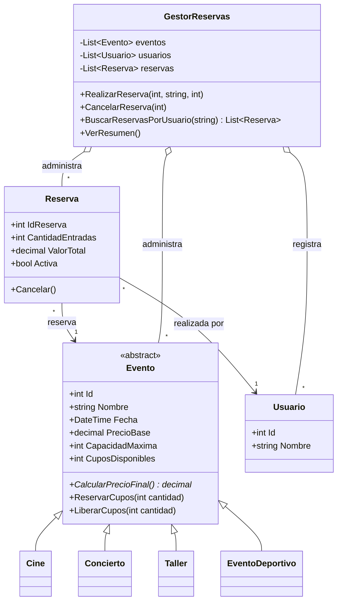

# PLANAZO - Gestión de eventos y reservas

Aplicación de consola en C# y .NET para consultar eventos, reservar y cancelar entradas, controlar cupos y consultar el resumen de reservas.

## Funcionalidades

- Incluye películas, conciertos, talleres y un evento deportivo de ejemplo.
- Calcula el precio con una regla polimórfica: cine conserva el precio base, concierto aumenta un 15 %, taller descuenta un 10 % y evento deportivo aumenta un 20 %.
- Valida nombres, cantidades, identificadores, capacidades y cupos.
- Descuenta cupos al reservar y los devuelve al cancelar. Una reserva cancelada no se puede cancelar de nuevo.
- Registra automáticamente a cada usuario por nombre y permite consultar todas sus reservas.
- Muestra eventos, reservas y un resumen de las reservas activas.
- Mantiene los cambios en memoria durante la ejecución; no usa persistencia en archivos o base de datos.

## Requisitos y ejecución

Se necesita el SDK de .NET 10. Desde la carpeta que contiene `PLANAZO-POO-CSharp.csproj`, ejecuta:

```bash
dotnet run
```

El proyecto no requiere paquetes externos.

## Menú

```text
1. Ver eventos disponibles
2. Consultar evento
3. Reservar entradas
4. Ver reservas realizadas
5. Cancelar una reserva
6. Ver resumen de reservas
7. Consultar reservas por usuario
0. Salir
```

La opción 7 se agregó para consultar las reservas asociadas a un usuario. Los usuarios se identifican por nombre y se reutiliza el mismo registro si se repite el nombre sin distinguir mayúsculas/minúsculas.

## Clases y relaciones

- `Evento` es la clase abstracta con los datos comunes y los métodos validados para reservar y liberar cupos.
- `Cine`, `Concierto`, `Taller` y `EventoDeportivo` heredan de `Evento` e implementan `CalcularPrecioFinal()` con su regla.
- `Usuario` representa a quien realiza reservas.
- `Reserva` asocia un usuario con un evento y conserva cantidad, total y estado.
- `GestorReservas` administra las colecciones de eventos, usuarios y reservas; valida las operaciones y muestra listados y resúmenes.
- `Program` presenta el menú, recoge entradas y comunica errores esperados sin cerrar la aplicación.



## Conceptos de POO

- **Abstracción:** `Evento` reúne los datos y operaciones comunes y declara `CalcularPrecioFinal()` como abstracto; no se instancia directamente.
- **Herencia:** `Cine`, `Concierto`, `Taller` y `EventoDeportivo` reutilizan la base `Evento`.
- **Polimorfismo:** el gestor almacena elementos como `Evento` y llama al mismo método `CalcularPrecioFinal()`. Cada subtipo calcula su precio sin modificar al gestor.
- **Encapsulamiento:** los datos de los eventos, usuarios y reservas tienen propiedades de solo lectura; el estado de reserva y los cupos solo cambian mediante métodos validados.
- **Asociación y composición:** cada `Reserva` mantiene referencias al `Usuario` y al `Evento`; `GestorReservas` administra las colecciones de todos ellos.
- **Constructores y colecciones:** los constructores validan e inicializan objetos y el gestor usa `List<T>` para mantenerlos durante la sesión.
- **Excepciones:** las reglas del modelo y del gestor notifican entradas inválidas, cupos insuficientes, elementos inexistentes o cancelaciones repetidas; el menú captura esos errores para continuar.

### Pregunta de sustentación

`Evento` evita duplicar en `Cine`, `Concierto` y `Taller` atributos y reglas compartidas, como nombre, fecha, capacidad y control de cupos. Además, el método abstracto obliga a que cada tipo defina su precio. Por ejemplo, `Concierto.CalcularPrecioFinal()` aplica `PrecioBase * 1.15m`, mientras que `Taller.CalcularPrecioFinal()` aplica `PrecioBase * 0.90m`. Para agregar otro tipo, `EventoDeportivo` hereda de `Evento` e implementa su regla (`PrecioBase * 1.20m`); el resumen y la gestión existentes pueden seguir trabajando con `Evento` sin cambiar su lógica.

## Casos de prueba

Prueba manualmente desde el menú:

1. Reserva válida: evento `1`, persona `Ana Pérez`, cantidad `2`. Debe crear una reserva y reducir los cupos en 2.
2. Exceso de cupos: intenta reservar `51` entradas para el evento `1` (inicia con 50). Debe mostrar el error y conservar los cupos.
3. Cantidad negativa: intenta reservar `-1`. Debe rechazar la operación.
4. Cancelación: cancela la reserva creada; los cupos deben volver a su valor anterior.
5. Doble cancelación: intenta cancelar la misma reserva otra vez; debe informar que ya estaba cancelada sin alterar los cupos.
6. Evento inexistente: consulta el ID `999`; debe indicar que no existe.
7. Precios: consulta los eventos y comprueba que la película mantiene el precio base, el concierto lo aumenta en 15 %, el taller lo reduce en 10 % y el evento deportivo lo aumenta en 20 %.
8. Usuario: crea más de una reserva con el mismo nombre y consulta la opción 7; deben aparecer todas las reservas de esa persona, incluidas las canceladas.

## Capturas

Guarda en `Capturas/` capturas reales de la aplicación ejecutándose y de los casos anteriores antes de publicar el repositorio. No se incluyen imágenes generadas o simuladas como evidencia. Se recomienda capturar: menú y eventos con sus precios, una reserva correcta, una validación fallida, una cancelación con los cupos recuperados y el resumen de reservas.
